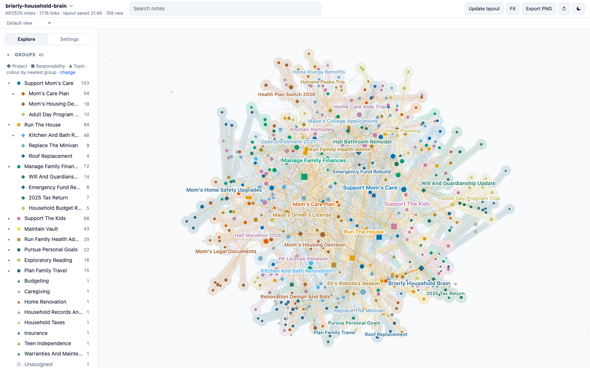

# Brierly Household Brain

A demo Second Brain: about 530 linked Markdown notes holding the working memory of a fictional family household. Clone it, open the folder, and explore what a personal vault looks like after two years of daily use: a renovation, an ageing parent's care, two teenagers, health admin, money and taxes, trips, cars and appliances, and the decisions and open questions that connect them.



**[Explore this vault in the live demo](https://mfoll.github.io/brain-graph-demo/?vault=brierly-household-brain)**: its map in Brain Graph, in your browser, with nothing to install.

> [!warning]
> Everything about the household is fictional: the Brierly family, every person, the town of Pellbrook, the employers, school, contractors, care agency, insurer, credit union, health plan, car and appliance brands, destinations and every number. Any resemblance to real people or organizations is accidental. Only the Sources marked as encyclopedia articles or tool documentation are real.

## What it shows

The vault was deployed from the [Second Brain template](https://github.com/mfoll/second-brain-template), which adds operating rules, workflows and a decision record to the [Portent](https://github.com/refactoringhq/portent) note model. Everything is plain files: Markdown notes with YAML frontmatter, typed relationships (`belongs_to`, `related_to`, `has`) and wikilinks. No app, database or index is required.

| Area | What to look at |
| --- | --- |
| Structure | 8 Responsibilities at the root, about 25 Projects under them, 10 Topics as lateral context; every note rolls up to a Responsibility. |
| Memory | About 180 Sources, 50 Events, 35 Questions, 30 Concepts, 15 Opinions, 17 Recaps, 40 people. |
| Real material | About 60 Sources are real Wikipedia articles or tool documentation pages, cited with title, URL and access date, summarized in our own words. Their "Why It Matters" sections describe how the fictional family used them. |
| Privacy | Medical and financial details stay in their own systems (patient portals, a password manager, a scanned document archive, a fire safe); the vault records where they are, who has access and what was decided. Notes about the teenagers stay factual and minimal. |
| Operations | `AGENTS.md`, Type notes, Procedures, Skills and ADRs from the template, unchanged except for the deployment steps. |
| History | Git history from January 2025 to October 2026, one commit for each month that had captures. |

## Open it

- **Any Markdown editor.** Clone the repository and open the folder; notes sit flat at the root by design. Start from [vault](vault.md).
- **[Tolaria](https://tolaria.md/).** Open the folder as a vault for typed sidebars, relationship panels and saved views.
- **[Brain Graph](https://github.com/mfoll/brain-graph).** See the whole vault as a map colored by project:

  ```bash
  npx github:mfoll/brain-graph path/to/second-brain-demo-household
  ```

- **A coding agent.** Run Claude Code, Codex or Gemini CLI in the folder. They read [AGENTS](AGENTS.md) (through `CLAUDE.md` and `GEMINI.md` where needed) and follow the vault's Procedures.

## Try this

Each question has a known answer in the vault, so you can check what an agent finds.

| Ask | Where the answer lives |
| --- | --- |
| Why did we put a curbless shower in the hall bathroom? | A design meeting on 2025-11-18 chose it for Mom's visits and for our own later years. See [hall-bathroom-remodel](hall-bathroom-remodel.md) and [bathroom-design-meeting-2025-11-18](bathroom-design-meeting-2025-11-18.md). |
| Which health plan are we choosing for 2027, and why not stay on the high-deductible plan? | Chosen on 2025-11-10, partly reversed on 2026-10-21. See [open-enrollment-2027](open-enrollment-2027.md), [open-enrollment-review-2026-10-21](open-enrollment-review-2026-10-21.md) and the daily Recap of 2026-10-21. |
| What did we agree about Mom's care, and who disagrees? | A family call on 2026-07-26 agreed an aide trial; one sibling still wants a different plan. See [family-care-call-2026-07-26](family-care-call-2026-07-26.md). |
| Should Mom stay in her house? | Still open. See [should-mom-stay-in-her-house](should-mom-stay-in-her-house.md). |
| How far over budget is the renovation, and what did it cost us elsewhere? | Two change orders and the appliances; the overrun drew down the emergency fund. See [renovation-budget-tracker](renovation-budget-tracker.md) and [emergency-fund-rebuild](emergency-fund-rebuild.md). |
| Why are we replacing the minivan now? | A new teen driver, an old car and a repair quote; the parents disagree. See [replace-the-minivan](replace-the-minivan.md) and [should-maya-drive-the-old-minivan](should-maya-drive-the-old-minivan.md). |
| Where do we keep Mom's medical information? | Not in the vault. See [moms-care-documents-index](moms-care-documents-index.md) and [sensitive-records-stay-at-source](sensitive-records-stay-at-source.md). |

Workflows to try with an agent:

- **Resume a project:** "Resume the Kitchen And Bath Renovation."
- **Process the Inbox:** about eight raw captures from the last weeks of October 2026 have `_organized: false`; each has an obvious home.
- **Ingest a source:** give any Wikipedia article on home renovation, caregiving or household budgeting and ask where it belongs.
- **Lint the vault:** the audits should report one link to a missing note, one Person reached only through a Project's `has` list and one Concept that belongs to nothing, all left in on purpose. Informational lines, such as external contacts without a parent, are expected.

## Scope and privacy

The fictional family's house, cars and appliances, the care of Nathan's mother, the teenagers' schooling and activities, health admin, finances, travel and Nathan's personal goals. No medical records, account numbers, policy numbers or credentials: notes point to patient portals, the family password manager, a scanned document archive and the fire safe through Source notes. Notes about the children cover only schedules, deadlines and logistics.

## Template updates

The vault was deployed from the template on 2026-10-23. Later template improvements can be brought in with [Upgrade an Existing Vault From the Template](upgrade-existing-vault-from-template.md), as a reviewed change: an agent proposes each change, and a person approves it. Never run it unattended. A vault in use is expected to differ from the template on purpose, in its ADRs, Procedures, Skills and instructions.

## How it was made

An AI agent drafted the world specification (the family, people, projects, timeline and the storylines behind the questions above) and a person reviewed and changed it. AI agents then wrote the notes from it, one per area of the household, and retrieved the real articles from Wikipedia. The links, frontmatter, cross-area consistency and source metadata were checked with the template's lint scripts and against the live pages.

## Storage and backup

The notes are plain files, and their history is this Git repository. To undo edits made while trying the demo, run `git checkout .`; `git clean -n` lists any new files, which `git clean -f` would delete.

## More example vaults

This is one of nine fictional vaults deployed from the same template, each kept by a different kind of person: a lab head, a café owner, a teacher, a freelance designer, a parent running a household, a sports club chair, a novelist, a start-up engineering lead and an HR assistant. The [template README](https://github.com/mfoll/second-brain-template#example-vaults) lists them all.

## Licence

MIT, see `LICENSE`, which also covers the template material. `THIRD_PARTY_NOTICES.txt` lists upstream notices. Cited articles and documentation remain under their own licences; the notes contain only their metadata and our own summaries.
